# Benchmarks

{ .kf-hero }

## KAN vs MLP at equal FLOPs

`benchmarks/fair_comparison.py`, following KANbeFair: same optimiser, steps
and data, FLOPs counted by `kanforge.flops`; CPU, float32, seed 0, 18.10.2026.

**Summary** (best of each family within 10⁵ FLOPs per sample):

| task | best KAN | best MLP | |
|---|---|---|---|
| exp(sin(πx₁) + x₂²) | RMSE 1.5e-3 (B-spline) | 9.0e-2 | KAN ~60x more accurate |
| x₁ · x₂ | 4.3e-4 (B-spline) | 5.0e-3 | ~12x |
| sin(x₁)e^(−x₂²) + x₃/(1 + x₄²) | 9.9e-4 (B-spline) | 5.4e-3 | ~5x |
| Friedman-1 (smooth tabular) | 3.8e-3 (B-spline) | 2.1e-2 | ~5x |
| digits (classification) | accuracy 0.974 | 0.978 | MLP slightly better, clearly better at small budgets |

KANs win on smooth, low-dimensional functions — symbolic formulas and
physics — and are not better on high-dimensional classification, the same
picture as KANbeFair. One optimiser setting (Adam 3e-3, 3000 steps) for all
models: a tuned MLP narrows the regression gaps; the comparison is about
equal effort, not best possible results.

Full tables:

--8<-- "benchmarks/fair_results.md"

## Speed of the fused kernels

--8<-- "BENCHMARKS.md"
