# Bases

{ .kf-hero }

Every edge function is φ(x) = Σ_b c_b B_b(x; θ). A basis evaluates the B_b
for arrays of NumPy, PyTorch, MLX or JAX alike, shape `(..., in)` →
`(..., in, size)`, and their derivatives of any order:

```python
import numpy as np
import kanforge as kf

b = kf.BSpline(grid_size=5, order=3)
values = b(np.linspace(-1, 1, 7)[:, None])        # (7, 1, 8)
second = b.derivative(np.linspace(-1, 1, 7)[:, None], order=2)
kf.make_basis("chebyshev", degree=6)              # by name; also kf.make_basis(b.config())
```

| family | names (`make_basis`) | notes |
|---|---|---|
| splines | `bspline`, `nurbs`, `truncated_power`, `relu_kan` | per-input grids; NURBS weights and TruKAN knots trainable |
| polynomials | `chebyshev`, `chebyshev2`, `legendre`, `jacobi`, `fractional_jacobi`, `gegenbauer`, `hermite`, `laguerre`, `bernstein`, `gram`, `taylor` | input map tanh (default), identity or fractional power (fKAN) |
| bumps, wavelets | `rbf`, `rswaf`, `mexican_hat`, `morlet`, `dog` | centres on a grid or trainable (`learnable=True`) |
| periodic | `fourier`, `random_fourier` | trainable frequency scale optional |
| other | `rational` (GR-KAN), `neural` (tiny MLP per edge), `concat`, `bsrbf` | |

**Parameters and grids.** `basis.param_specs()` lists trainable parameters
(rational coefficients, wavelet centres, …) and fixed state such as grids
(`trainable=False`). Layers store them per input, per group of inputs or once
per layer.

**Derivatives** are analytic: polynomial families are stored as Chebyshev
coefficients and differentiated with Faà di Bruno's formula through their
input map; rational bases and NURBS use the quotient rule. They are checked
against autograd up to the third order in the tests.
