<style>.md-content__inner h1{display:none}</style>

# kanforge

{ .kf-hero }

Kolmogorov–Arnold Networks (KANs) for every backend. A KAN layer learns a
one-dimensional function on every edge, y_o = Σ_i φ_oi(x_i), instead of a
weight; kanforge gives you those layers with any basis, on any hardware, with
the tools to train, interpret and deploy them.

| | |
|---|---|
| **Backends** | PyTorch (CUDA, ROCm, Apple MPS, CPU), Apple MLX, JAX / Flax NNX — same parameters, models convert between them |
| **Bases** | 26: B-splines, NURBS, truncated powers, ReLU-KAN, 11 polynomial families, RBF, wavelets, Fourier, rational (GR-KAN), tiny networks, combinations — exact derivatives of any order |
| **Training** | per-input adaptive grids, grid refinement, conversion between bases, pykan regularisation, DropKAN, variance-preserving init, exact conversion of MLPs |
| **Speed** | fused Metal (MPS, MLX), Triton (CUDA) and Pallas (JAX) kernels with derivatives of any order — up to 9x faster on Apple silicon |
| **Interpretation** | tabulation, attribution, pruning, symbolic regression, formulas through SymPy, the kanpiler (formula → KAN) |
| **Blocks** | KAN convolutions, KAT transformer blocks, exact KAN surgery of Hugging Face models, graph layers, recurrent cells, PINN tools, DeepONet, FBKAN, KAN-ODEs |
| **Deployment** | lookup tables, int8, ONNX, Core ML, Verilog for FPGAs, one file format for all backends |

```python
import torch
import kanforge as kf
from kanforge.torch import KAN

model = KAN([2, 5, 1], kf.BSpline(5, 3))
y = model(torch.rand(64, 2) * 2 - 1)
```

Start with [Installation](install.md) and the [Quickstart](quickstart.md);
the [tutorials](tutorials/index.md) cover one task each. KANs are not a free
win over MLPs — see the [equal-FLOPs benchmarks](benchmarks.md) for where
they help.
